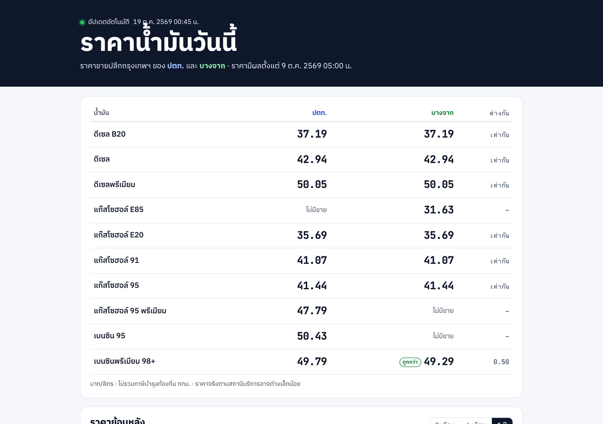

# ราคาน้ำมันวันนี้ · ปตท. เทียบ บางจาก

ระบบดึงราคาน้ำมันขายปลีกกรุงเทพฯ ของ ปตท. และบางจากอัตโนมัติวันละ 2 ครั้ง เก็บประวัติเป็น CSV / Excel และแสดงบนเว็บ

**เปิดดู: https://oilprice-th.vercel.app**



## ได้อะไรบ้าง

- **ราคาวันนี้ 2 แบรนด์ในตารางเดียว** จับคู่น้ำมันชนิดเดียวกันที่แต่ละแบรนด์ตั้งชื่อต่างกัน
  เช่น “ดีเซล” ของ ปตท. กับ “ไฮดีเซล S” ของบางจาก และบอกว่าแบรนด์ไหนถูกกว่า
- **ราคาพรุ่งนี้** เมื่อบางจากประกาศราคาล่วงหน้า หน้าเว็บขึ้นแถบแจ้ง และส่งข้อความเข้า Telegram ได้
- **กราฟย้อนหลัง 1 ปี** ของ ปตท. (ดึงย้อนหลังจากเว็บเซอร์วิสของ ปตท.) ส่วนบางจากเริ่มเก็บตั้งแต่ 19 ต.ค. 2569
- **ไฟล์ Excel** มีแท็บ “วันนี้” เทียบ 2 แบรนด์ แท็บรายวันของแต่ละแบรนด์ และข้อมูลดิบ:
  [`data/thai-oil-prices.xlsx`](data/thai-oil-prices.xlsx)
- **CSV** สำหรับดึงเข้า Google Sheets: `=IMPORTDATA("https://raw.githubusercontent.com/chasvitf/thai-oil-prices/main/data/daily.csv")`

## ทำงานอย่างไร

```
GitHub Actions (05:30 และ 19:00 น. ทุกวัน)
  → scraper/update.py
      ปตท.:   เว็บเซอร์วิส SOAP ทางการ (CurrentOilPrice)
      บางจาก: JSON ที่หน้าเว็บราคาน้ำมันของบางจากใช้ (ราคาวันนี้ + พรุ่งนี้)
  → จับคู่ชนิดน้ำมัน (scraper/products.py)
  → data/daily.csv  data/latest.json  data/thai-oil-prices.xlsx  (commit กลับเข้า repo)
  → หน้าเว็บอ่านไฟล์จาก repo โดยตรง จึงอัปเดตเองโดยไม่ต้อง deploy ใหม่
```

| ไฟล์ | หน้าที่ |
|------|---------|
| [`scraper/sources.py`](scraper/sources.py) | ขอข้อมูลและแปลงคำตอบของแต่ละแหล่ง (แยกการแปลงไว้ให้ทดสอบกับไฟล์ตัวอย่างได้) |
| [`scraper/products.py`](scraper/products.py) | จับคู่ชื่อน้ำมันของแต่ละแบรนด์ให้เป็นชนิดเดียวกัน ชื่อที่ไม่รู้จักจะถูกแจ้งใน log |
| [`scraper/store.py`](scraper/store.py) | ตารางรายวัน, `latest.json` และไฟล์ Excel (pandas + openpyxl) |
| [`scraper/update.py`](scraper/update.py) | งานประจำวัน: ถ้าแหล่งหนึ่งล่ม อีกแหล่งยังบันทึกต่อ และ workflow ขึ้นสีแดงให้เห็น |
| [`scraper/backfill.py`](scraper/backfill.py) | ดึงราคา ปตท. ย้อนหลังทีละวัน (วินาทีละ 1 ครั้ง) |
| [`.github/workflows/update.yml`](.github/workflows/update.yml) | ตั้งเวลา ทดสอบ ดึงข้อมูล แล้ว commit |
| [`public/`](public/) | หน้าเว็บ (HTML + JavaScript ล้วน กราฟวาดเองด้วย SVG) |

## รันเอง

```bash
python3 -m venv .venv && source .venv/bin/activate
pip install -r scraper/requirements.txt
cd scraper
python -m pytest -q tests             # ทดสอบตัวแปลงข้อมูลกับไฟล์ตัวอย่าง
python update.py                      # ดึงราคาวันนี้ อัปเดตไฟล์ใน data/
python backfill.py 2025-10-19 2026-10-18   # ดึงราคา ปตท. ย้อนหลัง
```

แจ้งเตือน Telegram: ใส่ `TELEGRAM_BOT_TOKEN` และ `TELEGRAM_CHAT_ID` ใน Settings › Secrets ของ repo
(ถ้าไม่ใส่ ระบบจะพิมพ์ข้อความแจ้งเตือนไว้ใน log ของ workflow แทน)

## ข้อจำกัด

- เป็นราคาขายปลีกกรุงเทพฯ ที่ยังไม่รวมภาษีบำรุงท้องถิ่น ราคาที่สถานีบริการอาจต่างเล็กน้อยตามพื้นที่
- บางจากไม่มีข้อมูลย้อนหลังให้ขอ ประวัติจึงเริ่มจากวันแรกที่ระบบรัน
- JSON ของบางจากไม่ใช่ API ที่ประกาศอย่างเป็นทางการ ถ้าเว็บเขาเปลี่ยนรูปแบบ ตัวดึงจะแจ้ง error ใน workflow
- ขอข้อมูลวันละ 2 ครั้ง และใส่ User-Agent ที่บอกว่าเป็นโปรแกรมนี้ เพื่อไม่ให้เป็นภาระกับเว็บต้นทาง

## ที่มาข้อมูล

- [เว็บเซอร์วิสราคาน้ำมัน ปตท. (PTTOR OilPrice)](https://orapiweb.pttor.com/oilservice/OilPrice.asmx)
- [ราคาน้ำมันบางจาก](https://www.bangchak.co.th/th/oilprice)

โปรเจกต์นี้ไม่ได้เกี่ยวข้องกับ ปตท. หรือบางจาก

---

ทำโดย [Chanavee Pimprong](https://chanavee.vercel.app) ·
[รับดึงข้อมูลจากเว็บ และเขียน Python ทำงานอัตโนมัติ บน Fastwork](https://fastwork.co/user/chasvitf/web-scraping-44359489) · โค้ดใช้สัญญาอนุญาต MIT
